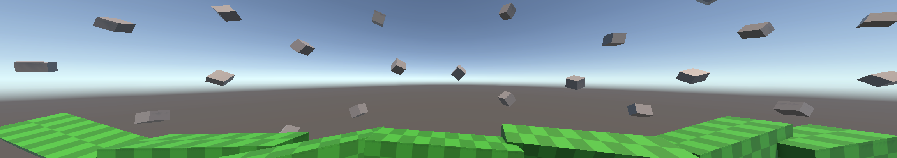

  
  
  

---

### :computer: About Me :
I am Savva Zhirnov, a Junior+ Unity/C# Developer and a fourth-year
Software Engineering student based in Bryansk, Russia.
- Built and released a [cross-platform Unity game](https://github.com/Nytrock/MadnessCooking)
- Experienced with C#, Unity, ScriptableObjects, uGUI, Animator, Localization, REST API integration, SSE, and custom editor tools
- Interested in game development, simulations and interactive applications
- Open to remote Junior+ Unity Developer and internship opportunities
- Contact: savvazhirnov@gmail.com
---

### :hammer_and_wrench: Languages and Tools:

  &nbsp;
  &nbsp;
  &nbsp;
  &nbsp;
  &nbsp; 

---

### :bar_chart: My Stats :

